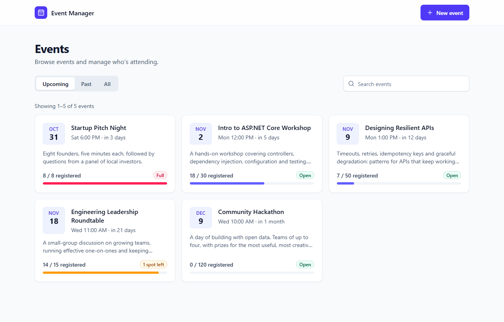
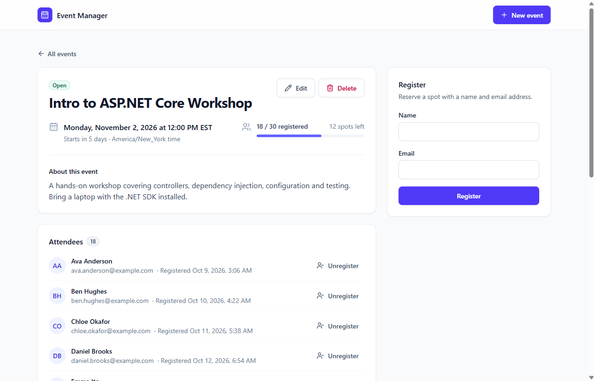

# Event Management

A full-stack app for managing events and attendee registrations: an **ASP.NET Core (.NET 10) REST API**
with in-memory storage, and a **React + TypeScript (Vite)** frontend.



- **Events:** create, view, edit and delete events (title, description, date and time, max capacity), and
  browse upcoming, past or all events with search and pagination.
- **Registrations:** register attendees with a name and email address, see who is attending, and
  unregister them.
- **Business rules** are enforced by the API and reflected in the UI: no registering for past events, no
  exceeding capacity, and no registering the same person twice for the same event.

**Stack:** ASP.NET Core 10 (controllers), xUnit · React 19, TypeScript 7, Vite 8, React Router 7, TanStack
Query 5, Tailwind CSS 4, Vitest + Testing Library.

## Contents

- [Quick start](#quick-start)
- [Running the tests](#running-the-tests)
- [Business rules](#business-rules)
- [API reference](#api-reference)
- [Architecture](#architecture)
- [Design decisions and trade-offs](#design-decisions-and-trade-offs)

## Quick start

### Prerequisites

- [.NET SDK 10](https://dotnet.microsoft.com/download/dotnet/10.0)
- [Node.js](https://nodejs.org/) 22.22+, 24.15+ or 26+, with npm (24 LTS recommended; the test tooling needs these versions)
- Optional: [Docker](https://www.docker.com/), to run everything with one command

### Run locally

Start the API (terminal 1):

```bash
cd backend
dotnet run --project src/EventManagement.Api
```

The API listens on **http://localhost:5080**, with Swagger UI at http://localhost:5080/swagger. In Development
the store is seeded with demo events: upcoming, nearly full, full, empty and past.

Start the frontend (terminal 2):

```bash
cd frontend
npm install
npm run dev
```

Open **http://localhost:5173**. The Vite dev server proxies `/api` to the API, so no CORS setup is needed.

### Run with Docker

```bash
docker compose up --build
```

Open **http://localhost:8080** for the app (nginx serves the production build and proxies `/api`), and
http://localhost:5080/swagger for the API. Both ports are published on `127.0.0.1` only, so the app, which has
no authentication, can't be reached from other machines. The API container runs in Production;
`docker-compose.yml` turns on Swagger UI and the demo events with `OpenApi__Enabled` and `Seeding__Enabled`.

Both containers run as non-root users on a read-only filesystem (with a `tmpfs` for `/tmp`), with all Linux
capabilities dropped and `no-new-privileges`. The API is limited to 512 MB of memory and restarts if it
crashes. nginx (the unprivileged 1.30 image) answers only for `localhost` and `127.0.0.1`, hides its version,
and sends a Content-Security-Policy, `X-Frame-Options`, `X-Content-Type-Options`, `Referrer-Policy` and
`Permissions-Policy` with every response.

### Configuration

| Setting | Where | Default | Purpose |
| --- | --- | --- | --- |
| `Seeding:Enabled` | `appsettings*.json`, or env `Seeding__Enabled` | `true` in Development and in Docker | Load the demo events at startup |
| `OpenApi:Enabled` | `appsettings*.json`, or env `OpenApi__Enabled` | `true` in Development and in Docker | Serve the OpenAPI document (`/openapi/v1.json`) and Swagger UI (`/swagger`, which `/` redirects to) |
| `AllowedHosts` | `appsettings.json`, or env `AllowedHosts` | `localhost;127.0.0.1;[::1]` | Host names the API answers to (ports are ignored). Any other `Host` gets `400`, which stops DNS-rebinding pages from using the API; add a name to serve the API under it |
| `Cors:AllowedOrigins` | `appsettings.json` | `http://localhost:5173`, `http://localhost:4173` | Origins allowed to call the API directly |
| `API_PROXY_TARGET` | frontend environment | `http://localhost:5080` | Where the dev/preview server proxies `/api` |
| `VITE_API_BASE_URL` | frontend environment, at build time | same origin | API origin when the app is not served behind a proxy. The Docker image's Content-Security-Policy allows only same-origin requests, so another origin also has to be added to `connect-src` in `frontend/nginx.conf` |

Data lives in memory, so it resets whenever the API restarts.

## Running the tests

```bash
dotnet test backend/EventManagement.slnx
```

```bash
cd frontend
npm test
npm run lint
npm run build
```

- **Backend: 203 xUnit tests.**
  - The event aggregate's rules and their boundaries. An event starting exactly now counts as past, and a
    duplicate registration is reported before "full". The text and email rules: invisible and blank-looking
    characters, text-direction overrides, and other spellings of the same address.
  - Concurrency: 200 parallel registrations for 50 spots yield exactly 50 registrations, and 50 parallel
    duplicates yield exactly one.
  - The services against the real in-memory store with a fake clock: filtering, search, paging, ordering, and
    an event turning past as time moves on.
  - HTTP integration tests through `WebApplicationFactory`: status codes, `Location` headers, problem
    details and validation keys, host filtering, the API docs switch, and the 32 KB body limit (on a real
    Kestrel server, because the in-memory test server doesn't enforce it).
- **Frontend: 187 Vitest tests.** The date, validation and URL-state helpers; the API client's error handling;
  status and capacity logic; and components: the event form, registration panel, attendee list (including
  optimistic unregister and rollback), search box, events list (including paging and announcements of
  results), details page (including not found and out-of-date data), create and edit pages (including leaving
  while a save is in flight), the delete flow, toasts, focus on navigation, and where focus goes when the
  control that had it disappears.

CI runs both suites on pushes to `main` and on pull requests ([`.github/workflows/ci.yml`](.github/workflows/ci.yml)).

## Business rules

| Rule | Behavior |
| --- | --- |
| No registering for past events | An event is **past** once its start time is reached. Registering for it fails with `409 event_in_past`. |
| No exceeding capacity | Registering for a full event fails with `409 event_full`. |
| No double registration | Authentication is out of scope, so an attendee is identified by **email address**, compared case-insensitively after trimming, with an internationalized domain matching its ASCII form (`bücher.example` = `xn--bcher-kva.example`). Addresses containing whitespace or characters that display as nothing, quoted local parts or a trailing dot on the domain are rejected (`400`), so the same address can't be registered twice by spelling it differently. A second registration fails with `409 already_registered`. |
| Clean text | Titles and attendee names need at least one visible character, and can't contain line breaks, tabs, other control characters or text-direction overrides (`400`). Descriptions may contain line breaks and tabs, but no other control characters or overrides (`400`). |
| Valid dates | New events, and edits, must be dated in the future (`400`). |
| Capacity vs. registrations | Max capacity can't be lowered below the number of people already registered (`409 capacity_below_registrations`). |
| Past events are locked | Once an event has started, its details and attendee list can no longer change (`409 event_in_past`). It can still be deleted. |

Invalid input is always reported first (`400`), whatever the event's state: a malformed email gets a `400`
even for a past or full event. Registration checks then run in a fixed order: the event has started, then the
person is already registered, then the event is full. Someone who is already registered for a full event is
therefore told they're registered, not that it's full.

## API reference

The base URL is `http://localhost:5080`. JSON is camelCase. Dates are ISO 8601 and returned in UTC. Request
dates must include an offset (`Z` or, for example, `+01:00`); a date without one is rejected because its
instant would be ambiguous, with "Event date must be a date and time with a UTC offset, such as
2030-11-15T18:00:00Z." under `errors.date`. Numbers must be JSON numbers. A body that isn't valid JSON gets
the generic message "The input was not valid.". Request bodies must be
`application/json` (`415` otherwise) and at most 32 KB (`413` otherwise). The full interactive contract is in
Swagger UI (`/swagger`, from `/openapi/v1.json`), served when `OpenApi:Enabled` is true.
[`EventManagement.Api.http`](backend/src/EventManagement.Api/EventManagement.Api.http) has a runnable request
for every endpoint, including the error cases.

| Method | Path | Success | Errors |
| --- | --- | --- | --- |
| `GET` | `/api/events?status=&search=&page=&pageSize=` | `200` page of events | `400` |
| `GET` | `/api/events/{id}` | `200` event | `404` |
| `POST` | `/api/events` | `201` event + `Location` | `400`, `413`, `415` |
| `PUT` | `/api/events/{id}` | `200` event | `400`, `404`, `409`, `413`, `415` |
| `DELETE` | `/api/events/{id}` | `204`, also deleting its registrations | `404` |
| `GET` | `/api/events/{id}/registrations` | `200` registrations, oldest first | `404` |
| `GET` | `/api/events/{id}/registrations/{registrationId}` | `200` registration | `404` |
| `POST` | `/api/events/{id}/registrations` | `201` registration + `Location` | `400`, `404`, `409`, `413`, `415` |
| `DELETE` | `/api/events/{id}/registrations/{registrationId}` | `204` | `404`, `409` |
| `GET` | `/health` | `200` | |

List parameters:
- `status`: `all` (default), `upcoming` or `past`.
- `search`: matches the title or description, case-insensitively.
- `page`: default 1.
- `pageSize`: 1–100, default 20.

Upcoming events are sorted soonest first, past events most recent first.

An event looks like this. The registration figures are computed, so the UI never has to count attendees:

```json
{
  "id": "01a11a10-c43b-7f0d-85b6-4fda5db730df",
  "title": "Startup Pitch Night",
  "description": "Eight founders, five minutes each, followed by questions from a panel of local investors.",
  "date": "2026-10-31T22:00:00+00:00",
  "maxCapacity": 8,
  "registeredCount": 8,
  "availableSpots": 0,
  "isFull": true,
  "isPast": false,
  "createdAt": "2026-10-07T05:49:42.0583529+00:00",
  "updatedAt": "2026-10-07T05:49:42.0583529+00:00"
}
```

Errors are [RFC 9457 problem details](https://www.rfc-editor.org/rfc/rfc9457) with a human-readable `detail`
and a stable, machine-readable `code`. Validation errors list their messages per field under `errors`:

```json
{
  "type": "https://tools.ietf.org/html/rfc9110#section-15.5.10",
  "title": "Conflict",
  "status": 409,
  "detail": "This event is full (8 of 8 spots taken).",
  "code": "event_full",
  "traceId": "00-9b4b7f0d799c0fef75e7e6f79e687d41-54b37a077c0390e9-00"
}
```

| `code` | Status | Meaning |
| --- | --- | --- |
| `validation_failed` | 400 | One or more fields are invalid (see `errors`) |
| `event_not_found` | 404 | No event with that id |
| `registration_not_found` | 404 | The event has no registration with that id |
| `event_in_past` | 409 | The event has started, so it can't be registered for, unregistered from or edited |
| `event_full` | 409 | No spots left |
| `already_registered` | 409 | That email address is already registered for the event |
| `capacity_below_registrations` | 409 | The new capacity is lower than the number of registrations |
| `payload_too_large` | 413 | The request body is larger than 32 KB |
| `unsupported_media_type` | 415 | The request body isn't JSON |

Other problems the framework produces carry a code derived from their status, such as `not_found` or
`method_not_allowed`.

## Architecture



```
backend/
  src/EventManagement.Api/
    Controllers/      thin HTTP layer; ApiControllerBase maps errors to problem details in one place
    Contracts/        request/response DTOs with validation attributes
    Services/         use cases: look up, apply the domain operation at the current time, map to DTOs
    Domain/           Event aggregate (all business rules), Registration, error catalog
    Persistence/      in-memory repository and demo data seeder
    Infrastructure/   service registration, problem details conventions, JSON and OpenAPI setup
    Common/           Result and Error types
  tests/EventManagement.Api.Tests/
    Domain/  Services/  Persistence/  Api/
frontend/
  src/
    api/          fetch client (ApiError built from problem details), DTO types, endpoint functions
    queries/      TanStack Query keys, defaults, and query/mutation hooks
    components/   ui primitives, layout, events, registrations
    pages/        one component per route
    lib/          dates, validation, URL state, form and toast helpers
```

**Backend.** A request flows controller → service → `Event` aggregate → repository. The aggregate owns its
registrations and enforces every rule. Its methods take the current time as a parameter, so the rules are
deterministic, and the tests and the seed data (which creates history "in the past") control the clock.
Expected failures, such as a full event, are returned as `Result` values rather than thrown, and are turned
into problem details in one place. Exceptions are reserved for bugs.

**Frontend.** Pages compose small components. All server data goes through TanStack Query hooks, and
components never call `fetch` directly. The list's filters, search and page live in the URL, so refresh,
back/forward and shared links work. Forms validate on the client with the same limits as the API, and map the
API's field errors and conflict codes back onto the right fields.

**Code tour.**
- Business rules and concurrency: [`Domain/Event.cs`](backend/src/EventManagement.Api/Domain/Event.cs).
- Error handling: [`ApiControllerBase.cs`](backend/src/EventManagement.Api/Controllers/ApiControllerBase.cs)
  and [`EventErrors.cs`](backend/src/EventManagement.Api/Domain/EventErrors.cs).
- Data layer and caching: [`queries/`](frontend/src/queries).
- The details page: [`EventDetailsPage.tsx`](frontend/src/pages/EventDetailsPage.tsx).

## Design decisions and trade-offs

- **Identity by email.** With authentication out of scope, an attendee is their email address, compared by a
  normalized key (case-insensitive, with internationalized domains in their ASCII form), so another spelling
  of the same address can't take a second spot. Addresses that only look alike, such as one with a Cyrillic
  letter in place of a Latin one, are different addresses. With auth, registrations would reference a user id
  instead.
- **Validation.** The request contracts declare presence, lengths and ranges (which also documents the limits
  in OpenAPI) and check text and emails with the domain's own rules, so every field error comes back in one
  response. The domain owns every value rule and checks it again, before looking at the event's state, so the
  services and the seed data follow the same rules.
- **Concurrency.** Check-then-act rules (capacity, duplicates, capacity vs. registrations) must be atomic, or
  two people could take the last spot.
  - Each event has its own lock, so requests for different events never wait on each other.
  - Reads copy a consistent snapshot.
  - The concurrency tests above prove it holds under parallel load.
- **Efficient reads.**
  - Lookups by id are O(1) (`ConcurrentDictionary`).
  - Duplicate checks are O(1), using a set of normalized addresses per event.
  - Filtering, search and paging happen on the server.
  - Event responses include the registration counts, so the list page is one request with no per-event calls.
- **Efficient UI.**
  - Responses are cached briefly, and mutations update exactly the affected cache entries.
  - An event and its attendees load in parallel, and the details page renders immediately from the list's copy.
  - Search is debounced.
  - Paging keeps the previous page visible instead of flashing a skeleton.
  - Unregistering is optimistic, with rollback if the server refuses.
- **Out-of-date data.** A 404 or 409 from a save or a registration refreshes the event and the cached list
  pages. An event that turns out to have been deleted, whether on opening it or on deleting it, drops out of
  the cached lists, and deleting one that someone else already deleted counts as deleted. If a background
  refresh fails, the page keeps showing what it has, with a warning and a Retry button. After a save, the app
  only navigates if the user is still on that page.
- **Accessibility.** Moving to another page puts focus on its heading, as a full page load would, and so does a
  "not found" message replacing the page, or the error page shown when a page crashes. Changing only the query
  string, such as typing a search or turning a page, leaves focus where it is: on the last page, Next stays
  focused, though unavailable. When content that loads replaces the focused control (Retry, a link to a page that
  no longer exists, the registration form once the event fills up), focus moves to the start of what replaced it,
  and dismissing a toast returns focus to where it was before. A status region announces what a search, filter or
  page change found, naming the filters ("Showing 1–6 of 6 upcoming events matching “js”"). Success toasts close
  after 4 seconds but wait while hovered or focused; error toasts stay until dismissed.
- **Time.** The API stores and returns UTC and gets "now" from an injected `TimeProvider`. The UI shows and
  edits dates in the browser's time zone.
- **In-memory storage.** The repository is synchronous because nothing it does waits on I/O. Moving to a
  database would make it async. The per-event lock would give way to a transaction, a unique index on
  (event id, normalized email), and optimistic concurrency on the event row.
- **Not built (yet).** Authentication, a waitlist when an event is full, paging for very large attendee lists,
  per-event time zones, and end-to-end browser tests in CI.
